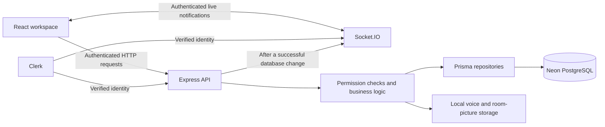

# WiseRoom architecture

WiseRoom is an AI collaboration workspace with persistent private rooms and Socket.IO live updates. Document ingestion and room-scoped retrieval-augmented generation (RAG) remain upcoming milestones; the public AI preview illustrates that planned workflow.

## Current system

## Responsibilities

| Layer | Location | Responsibility |
| --- | --- | --- |
| Frontend | `Client/src/` | Routes, authenticated API clients, UI state, composer and history |
| HTTP API | `Server/routes/`, `Server/controllers/` | Requests and responses for durable operations and uploads |
| Services | `Server/services/` | Membership, ownership, validation and transactional operations |
| Repositories | `Server/repositories/` | Room-scoped Prisma queries |
| Database | `Server/prisma/` | Schema, migrations and persisted users/rooms/messages/collaboration records |
| Realtime server | `Server/realtime/` | Authenticated connections, scoped notifications, presence and typing |
| Realtime client | `Client/src/realtime/` | Shared connection, token refresh, event subscriptions and reconciliation |
| Local media | `Server/data/` | Uploaded voice recordings and processed room pictures; excluded from Git |

## Data and permissions

Clerk provides identity. The server checks current room membership before returning room data or accepting writes. Owner-only actions are checked on the backend. Each room has one current owner; `createdById` retains the historical creator after an ownership transfer.

Messages, replies, reactions, saved state, read state and memberships persist in PostgreSQL. Message deletion clears content and leaves a tombstone, preserving ordering and existing replies. Room deletion cascades its related records and cleans up local media.

## Live delivery and recovery

HTTP APIs save data; Socket.IO sends identifiers-only notifications after successful changes. Browsers then fetch authorized data. The shared connection survives navigation within the signed-in workspace, while personal channels update other tabs, room previews and activity.

Reconnect/focus synchronization and a shared 60-second fallback recover persisted changes. Presence and typing are temporary process-local state. This implementation targets one backend instance and does not provide a durable event outbox. See [the realtime guide](realtime.md) for the event map, recovery details and verification limits.

## Link previews

Authenticated, message-scoped endpoints resolve page metadata and proxy bounded raster thumbnails. Public-address validation and pinned DNS protect outbound requests; image decoding, lazy loading and bounded process-local caches keep cards compact. Preview availability is optional and does not change message persistence. See [link previews](link-previews.md).

## Planned RAG pipeline

The remaining pipeline will carry room permissions through document upload, extraction, chunking, embeddings, vector retrieval, `@wise` generation and citations. The current repository does not yet implement that processing pipeline.

See the [RAG pipeline](../README.md#rag-pipeline) and [remaining milestones](../README.md#remaining-rag-milestones) for the intended architecture and scope.

## Related guides

- [Implementation and migration history](implementation.md)
- [Shared design system](design.md)
- [Local setup](../README.md#getting-started)
